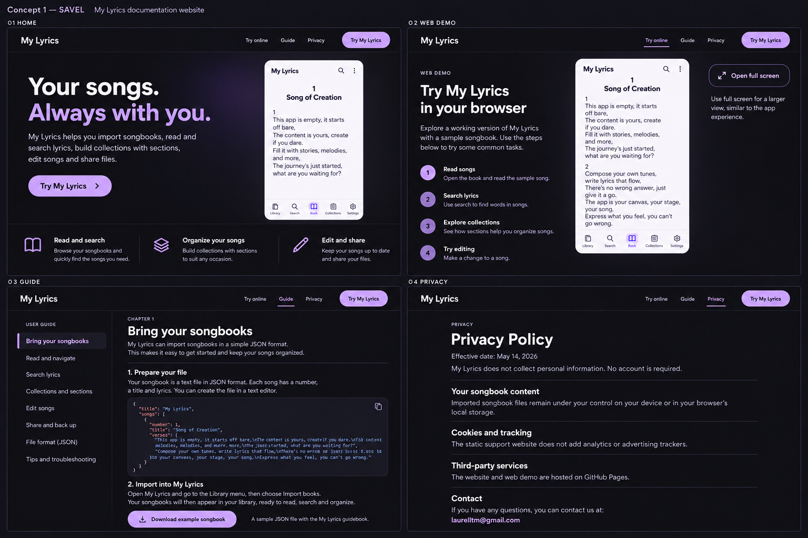
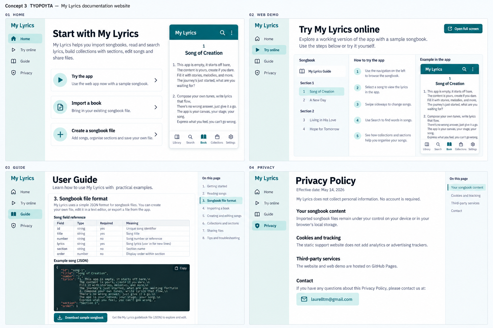
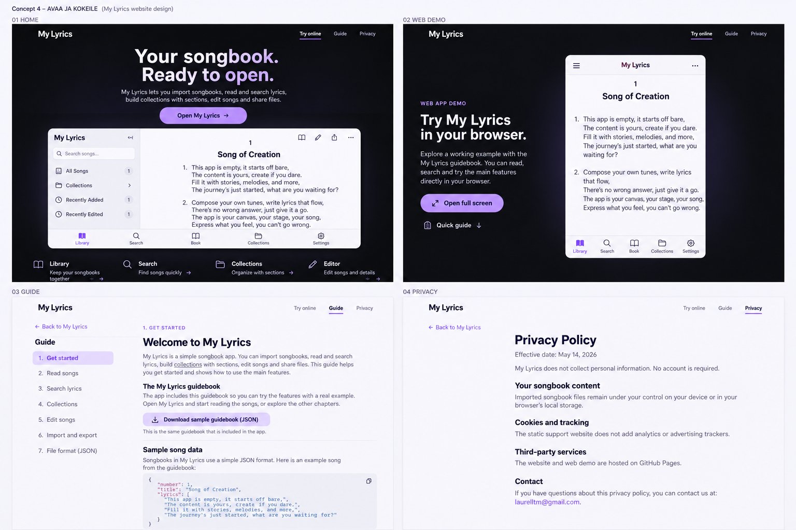
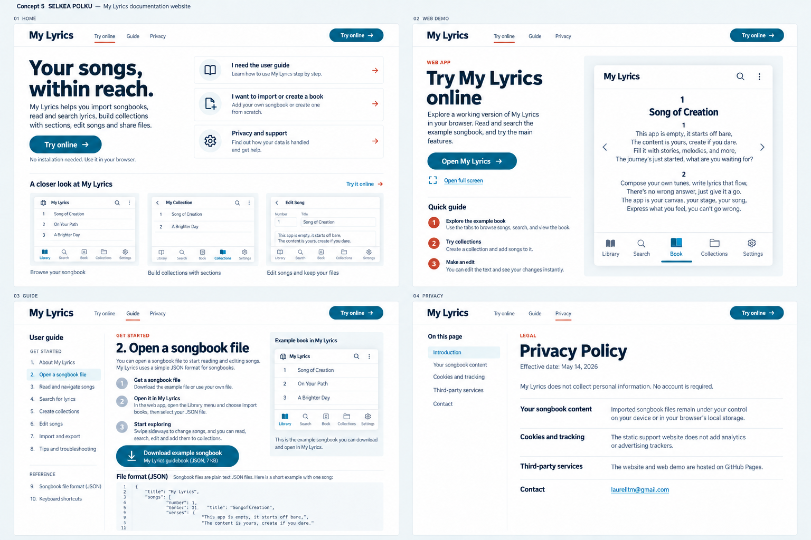

# My Lyrics — viisi vaihtoehtoa sivuston käyttöliittymäksi

17.10.2026 · Impeccable / shape · **vaihtoehto 2 valittu ja toteutettu**

Rajaus: dokumentaatiosivuston etusivu, web-demon esittely, käyttö- ja tiedostomuoto-ohje sekä tietosuojasivu. Flutter-sovelluksen sisäistä käyttöliittymää ei muuteta näiden ehdotusten perusteella. Jokainen vaihtoehto muodostaa kokonaisen sivuston; kyse ei ole viidestä väriversiosta samasta pohjasta.

[Avaa toteutettu sivusto](https://laurelltm.github.io/my-lyrics/) · [Katso hyväksytyn luonnoksen ja toteutuksen kuvavertailu](https://laurelltm.github.io/my-lyrics/design-comparison/)

Alkuperäiset viisi vaihtoehtoa säilyvät alla suunnitteluhistoriana.

## Katso ehdotukset kuvina

[Avaa visuaalinen vertailugalleria GitHub Pagesissa](https://laurelltm.github.io/my-lyrics/design-previews/).

Jokaisessa kuvataulussa on neljä päänäkymää: etusivu, web-demon esittely, ohjeet ja tietosuoja. Kuvat ovat kuvanluontityökalulla tehtyjä suunnitteluluonnoksia. Havainnollistavat tekstit ja sovelluksen esitykset eivät korvaa nykyisiä ohjeita tai tietosuojaselostetta. Suunnan valinta koskee sivustoa; sovelluksen sisäinen käyttöliittymä säilyy erillisenä.

### 1. Sävel — sovelluksen sisarsivusto

### 2. Laulukirja — toimitettu julkaisu

### 3. Työpöytä — ohjeet ja kokeilu rinnakkain

### 4. Avaa ja kokeile — demo pääosassa

### 5. Selkeä polku — kevyt tukipalvelu

## Valitse suunta

| Vaihtoehto | Ensivaikutelma ja rakenteellinen idea | Sopii erityisesti | Työmäärä suhteessa muihin |
|---|---|---|---|
| [1. Sävel — sovelluksen sisarsivusto](01-savel.md) | Tumma, luumu ja laventeli. Selkeä tuote-esittely, oikea demo ja erillinen ohjekeskus. | Sovelluksen ja sivuston yhtenäiseen identiteettiin. **Suositus.** | Keskitaso |
| [2. Laulukirja — toimitettu julkaisu](02-laulukirja.md) | Lämmin paperi, kirjallinen typografia ja lukuihin jaettu sisältö. | Rauhalliseen, helposti luettavaan dokumentaatioon. | Keskitaso |
| [3. Työpöytä — ohjeet ja kokeilu rinnakkain](03-tyopoyta.md) | Vasemmalla ohjenavigaatio, keskellä sisältö, oikealla aito demo. | Omien kirjojen tekijöille ja usein palaaville käyttäjille. | Suurin |
| [4. Avaa ja kokeile — demo pääosassa](04-avaa-ja-kokeile.md) | Web-sovellus on heti sivun pääasia; lyhyt ohjaus sen rinnalla. | Nopeaan kokeiluun ja puhelimella saapuville. | Keskitaso–suuri |
| [5. Selkeä polku — kevyt tukipalvelu](05-selkea-polku.md) | Valkoinen, vahva typografia ja tehtäväkohtaiset reitit. Yksi päätös kerrallaan. | Helposti ylläpidettävään, laajalle yleisölle sopivaan tukisivustoon. | Pienin |

Suosittelen vaihtoehtoa 1: se yhdistää sovelluksen tunnistettavan ilmeen, nopeasti avattavan web-version ja oikean lukukokemuksen ohjeille. Vaihtoehto 4 on vahvin, jos ensisijainen tavoite on saada kävijä käyttämään web-versiota heti. Vaihtoehto 3 painottaa enemmän tiedostojen tekijöitä kuin tavallista sovelluksen käyttäjää.

## Mitä nykyisestä sivustosta tutkittiin

Tarkastelu perustuu paikalliseen sivustoon, sen selaimessa näkyvään etusivuun ja web-demoon sekä lähteisiin `index.html`, `web-demo/index.html`, `web-demo/styles.css`, `web-demo/demo.js`, `README.md` ja `privacy-policy/index.html`.

Havaitut ongelmat, jotka jokainen vaihtoehto ratkaisee:

1. **Tuotenimi vaihtuu.** Etusivu käyttää My Lyrics -nimeä, demon esittely Open Songbook -nimeä. Yhteinen julkinen nimi on My Lyrics.
2. **Etusivu aloittaa tiedostojen rakentamisesta.** “Build and test songbook files” puhuttelee teknistä tekijää, mutta ei selitä tavalliselle käyttäjälle nopeasti, mitä sovelluksella voi tehdä.
3. **Yhteinen navigaatio puuttuu.** Etusivu, demo, ohje ja tietosuoja tuntuvat erillisiltä dokumenteilta. Demosta puuttuu selkeä paluu sivuston muihin osiin.
4. **Ohjelinkki vie raakamuotoiseen Markdown-tiedostoon.** `README.md` ei ole varsinainen luettava ohjesivu, jossa olisi sivun sisäinen navigaatio, mobiiliasettelu ja hakemistot.
5. **Demo on pitkän sisällön takana pienellä näytöllä.** Nykyisessä järjestyksessä esittely ja kolme ominaisuuskuvausta tulevat ennen kokeiltavaa sovellusta.
6. **Demon teksti puhuu toteutustekniikasta.** Flutter, iframe, staattinen deploy ja bundle-polku vievät tilaa käyttäjälle tärkeiltä tiedoilta. Ne kuuluvat kehittäjäohjeeseen.
7. **Puhelimen keinotekoinen laitekehys vie tilaa.** Dynaaminen saareke voi peittää oikean sovelluksen yläosaa. Käyttökelpoinen näyttöala on puhelimessa tärkeämpi kuin puhelimen kuva.
8. **Ulomman sivun scroll lukitaan hoverin tai fokuksen perusteella.** Tämä voi tehdä sivun ja upotetun sovelluksen välisestä liikkumisesta vaikeasti ennakoitavaa. Lukitus kuuluu korkeintaan käyttäjän itse avaamaan koko ruudun tilaan.
9. **Demo-loader ei kerro luotettavasti, onko sovellus valmis.** Iframen latautuminen ei yksin tarkoita toimivaa sovellusta. Ehdotuksissa käynnistys, hidas lataus ja virhe ovat omia tilojaan.
10. **Teksti on osin vanhaa.** Etusivu mainitsee vain iPhonen ja iPadin. Ohjeet tulee tarkistaa nykyisen Android-, web-, jako- ja varmuuskopiointitoteutuksen mukaan ennen uuden sivuston julkaisua.

Tässä ei ole tehty muodollista saavutettavuussertifiointia tai suorituskykymittausta. Väri- ja fonttivalinnat ovat ehdotuksia, joiden kontrastit ja eri kielten toimivuus testataan toteutuksessa.

## Kaikkien vaihtoehtojen yhteinen sisältö ja rajat

**Sivut:** Etusivu → Kokeile selaimessa → Ohjeet → Tiedostomuodot → Tietosuoja. Ohjeet ja tiedostomuodot voivat olla saman kokonaisuuden eri sivuja. Yhteystieto löytyy myös footerista.

**Todellinen sisältö:** kirjaston tuonti ja jako, laulujen selaaminen ja haku, suosikit, omat kokoelmat ja osiot, laulueditori, ulkoasu ja kieli, varmuuskopiointi ja palautus. Alustakohtaiset rajoitteet kerrotaan vasta toteutuksen tarkistamisen jälkeen; selainversiolle ei luvata iCloudia tai Google Drivea.

**Esimerkit:** vain sovelluksen oma englanninkielinen käyttöohjekirja ja repoissa oleva sallittu esimerkkidata. Ei käyttäjän oikeita virsikirjoja, kansia tai laulutekstejä kuvitukseen.

**Reitit:** `/`, `/web-demo/`, `/web-demo/app/` ja `/privacy-policy/` säilyvät. Luettavalle ohjeelle voidaan lisätä `/guide/` ja tiedostomuodoille `/guide/files/`. README säilyy kehittäjädokumenttina ja vanhana toimivana linkkinä. Tietosuojan juridista sisältöä tai kauppalinkkejä ei muuteta tämän UI-suunnitelman varjolla.

**Kielet:** kuvaukset tässä ovat suomeksi arvioinnin helpottamiseksi. Nykyinen sivusto on englanniksi. Ensitoteutuksen kielivalikoima on erillinen päätös; sivuston 40 käännöstä ei oleteta valmiiksi sovelluksen käännösten perusteella. Navigaatiossa varataan tila kielivalinnalle. Kieltä ei esitetä lipulla.

**Yhteinen laatutaso:** vähintään 44 × 44 px kosketuskohteet, selvä näppäimistöfokus, skip-linkki, semanttinen otsikkorakenne, tekstiä saa suurentaa 200 %, normaalitekstin kontrastitavoite 4.5:1, ei pelkän värin varaan jääviä tiloja. Ohjeen tekstipalsta 60–72 merkkiä. Koodiesimerkki saa scrollata omassa laatikossaan; koko sivu ei vaakasuunnassa. Vähennetty liike huomioidaan.

**Nopeus:** dokumentaatio toimii ilman Flutterin lataamista. Web-sovellus ladataan ensisijaisesti vasta käyttäjän avatessa demon. Jos suora demoreitti käynnistää sovelluksen heti, HTML-esittely ja paluulinkit näkyvät siitä riippumatta. Ei seuranta-analytiikkaa tai uusia ulkoisia fonttipyyntöjä oletuksena; fontit tarjotaan itse tai käytetään järjestelmäfontteja.

## Toteutuksen hyväksymiskriteerit valinnan jälkeen

- Kävijä tunnistaa My Lyricsin, löytää web-version ja pääsee ohjeisiin ensimmäisestä näkymästä.
- Jokaisen sivun mobiiliversio on suunniteltu erikseen; sitä ei vain pienennetä työpöydästä.
- Tarkistetaan 360, 390, 768, 1280 ja 1440 px leveydet sekä käyttäjän oma selainleveys.
- Demo: ensimmäinen käyttö, jo tallennettu kirjasto, lataus, latausvirhe, tallennustilan puute, suora koko ruudun linkki ja paluu.
- Ohje: pitkä otsikko, pitkä tiedostonimi, leveä JSON, näppäimistökäyttö ja tulostus.
- Tietosuojasivu on luettavissa ilman JavaScriptiä ja suoraan vanhalla URL-osoitteella.
- Julkaisu säilyttää toimivan sovelluksen, dokumenttilinkit ja GitHub Pagesin alipolun.

**Valintaa varten riittää vaihtoehdon numero.** Myös yhdistelmä on mahdollinen, esimerkiksi vaihtoehdon 1 ilme ja vaihtoehdon 2 ohjesivun lukurakenne. Sen jälkeen laaditaan valitusta kokonaisuudesta visuaalinen esikatselu ennen varsinaista uudistusta.
