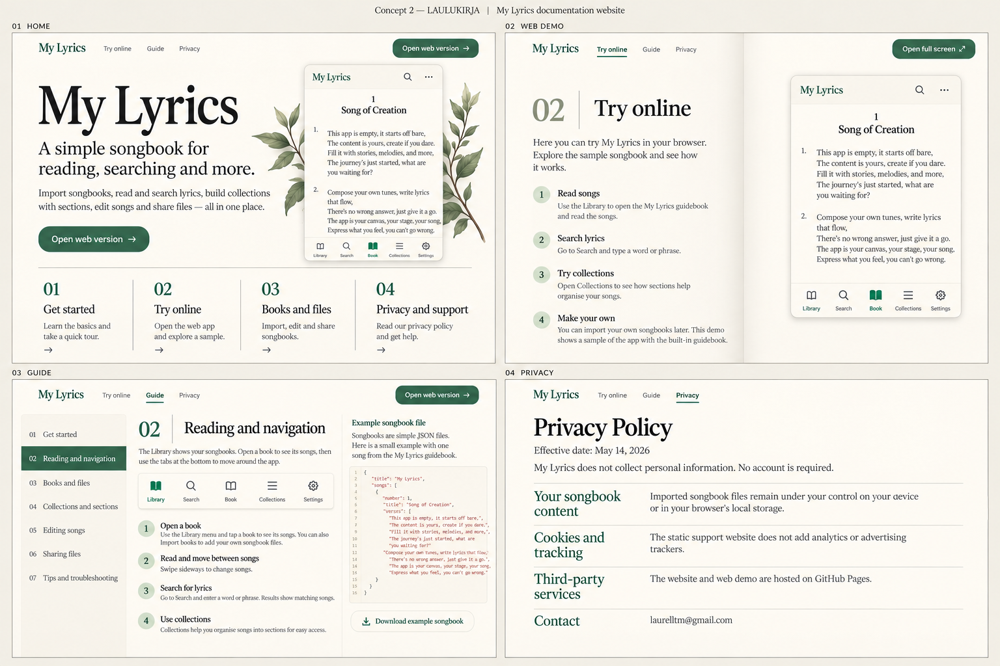
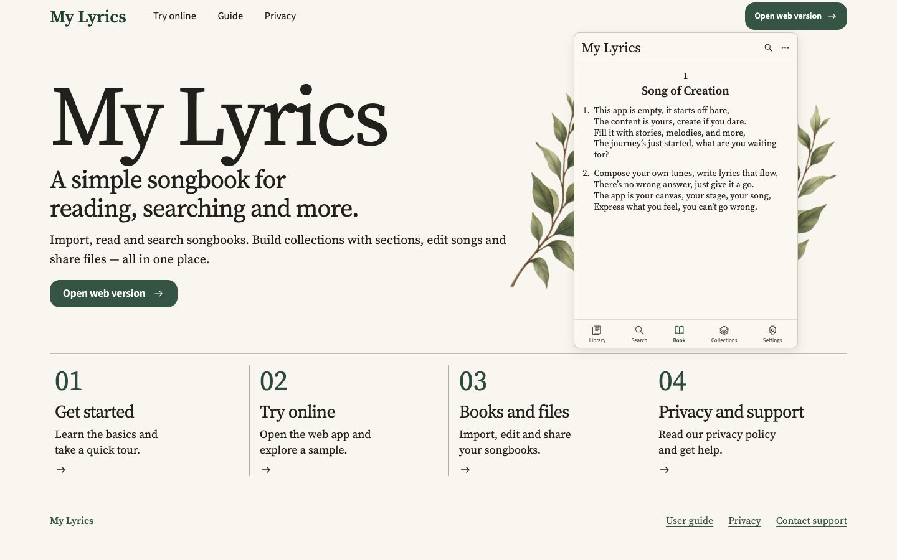
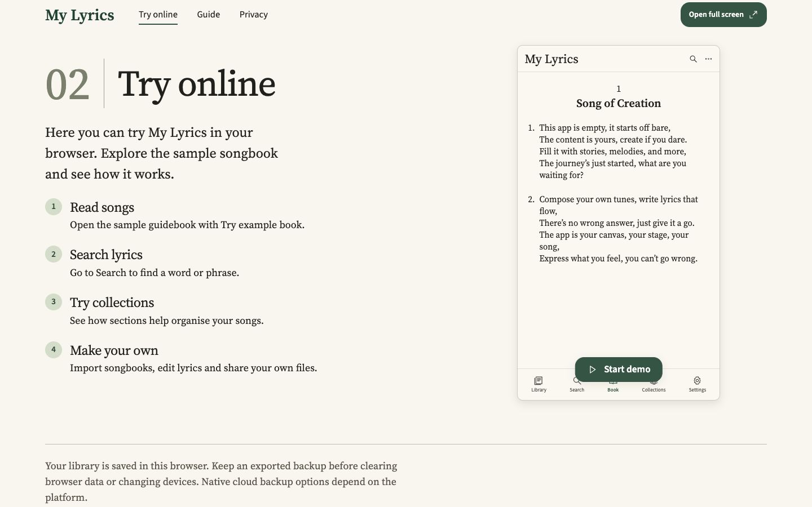
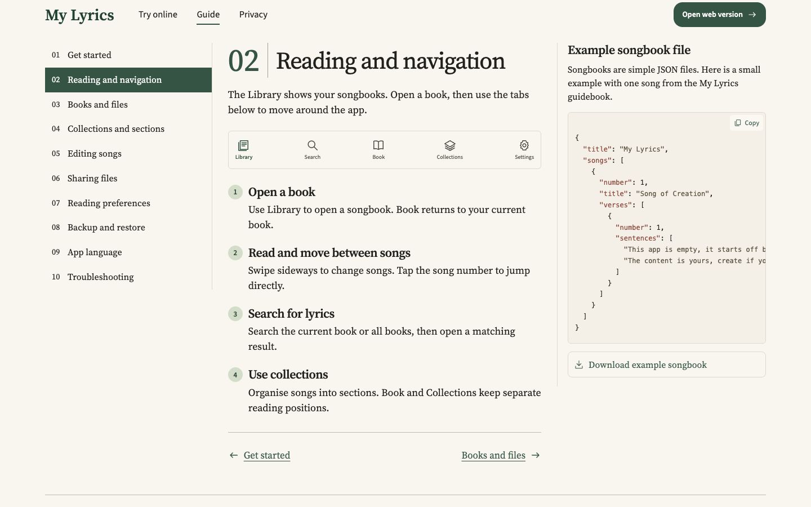
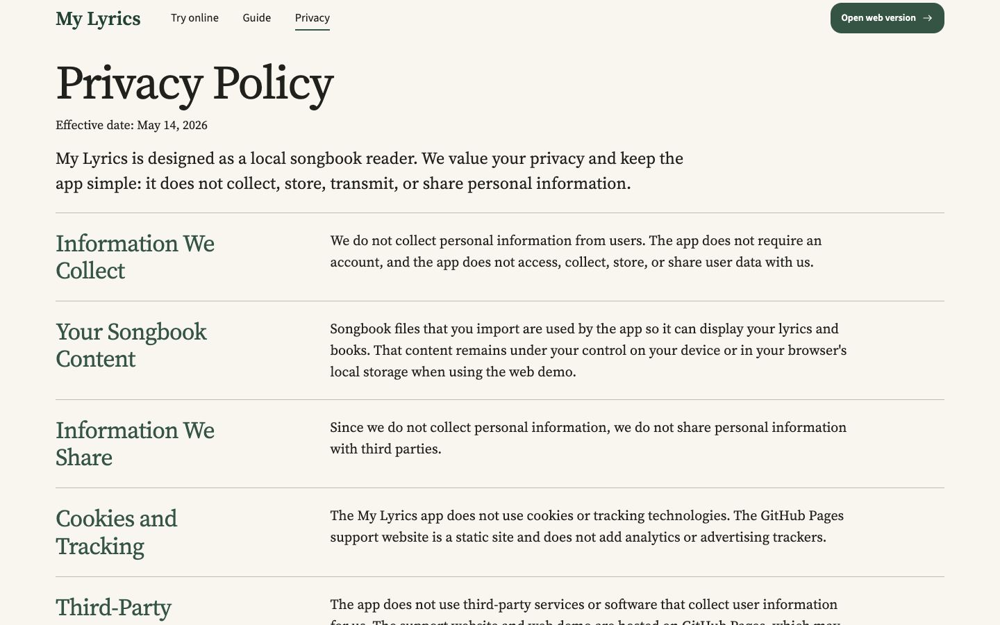

# Lämmin paperi · luonnos ja toteutus

[Kuvavertailu rinnakkain GitHub Pagesissa](https://laurelltm.github.io/my-lyrics/design-comparison/) · [Toteutettu sivusto](https://laurelltm.github.io/my-lyrics/)

## Hyväksytty luonnos

## Toteutettu etusivu

## Toteutettu web-demon esittely

## Toteutettu käyttöohje

## Toteutettu tietosuoja

Tietosuojasivun nykyinen teksti säilytettiin kokonaisena. Ohjeessa on kymmenen lukua nykyisistä ominaisuuksista. Sovelluksen oma käyttöliittymä säilyy erillisenä sivuston uudistuksesta.

## Puhelimella

[Koko etusivu](../../design-comparison/images/home-mobile-full.jpg) · [Demon esittely](../../design-comparison/images/demo-mobile-full.jpg) · [Käyttöohje](../../design-comparison/images/guide-mobile-full.jpg) · [Tietosuoja](../../design-comparison/images/privacy-mobile-full.jpg)

Kaikki toteutuskuvat ovat selaimesta otettuja, ja niissä käytetään vain sovelluksen omaa englanninkielistä esimerkkikirjaa. Rinnakkaiset vertailut käyttävät luonnoksen samoja 744 pikselin levyisiä näkymiä. Työpöytäkuvat ovat 1440 × 900 ja puhelinkuvat 390 pikseliä leveitä.
